<div align="center">

# 🍽️ UniBite

### University Canteen Food App

Browse campus food, save favourites, and manage a demo order — even offline.

</div>

---

## 📖 Table of Contents

- [Project Overview](#-project-overview)
- [Project Objective](#-project-objective)
- [Key Features](#-key-features)
- [Application Screenshots](#-application-screenshots)
- [Technologies Used](#-technologies-used)
- [Project Structure](#-project-structure)
- [Installation and Setup](#-installation-and-setup)
- [Offline Data Storage](#-offline-data-storage)
- [Important Notes](#-important-notes)

## 📌 Project Overview

UniBite is a React Native application for browsing food available at a university canteen. Students can search and filter dishes, view food details, save favourites, add food to a cart, and review demo orders.

The menu is stored locally in the application. Cart items, saved dishes, and demo orders are stored on the device.

## 🎯 Project Objective

The objective of UniBite is to provide students with a simple way to explore campus canteen food and manage a sample order using a mobile application.

## ✨ Key Features

- Browse food items from the local menu.
- Search for food by dish name or canteen.
- Filter dishes by category.
- Show vegetarian dishes only.
- View descriptions, ingredients, prices, and canteen details.
- Save and remove favourite dishes.
- Add dishes to the cart and change their quantities.
- Review a demo order and view order history.
- Use the application without public APIs or an online database.

## 📱 Application Screenshots

### Home

<details>
<summary>Show Home screenshots</summary>

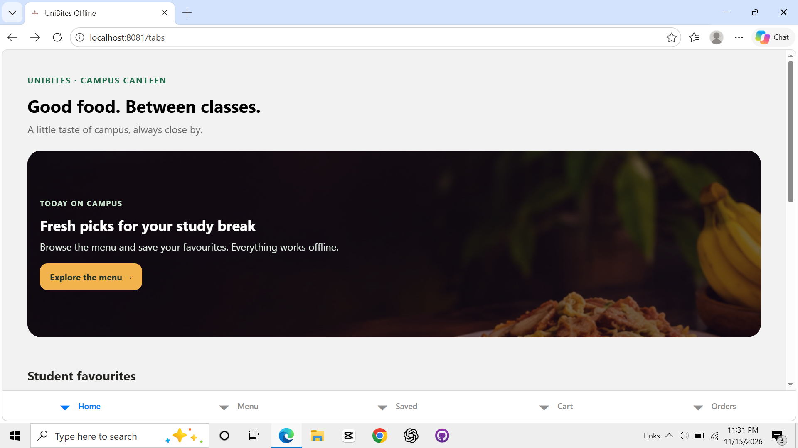
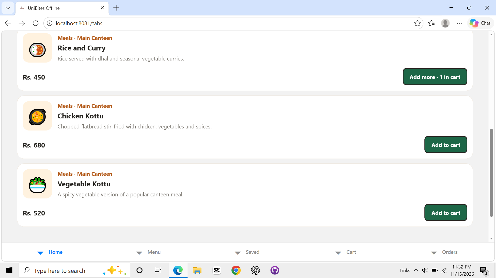
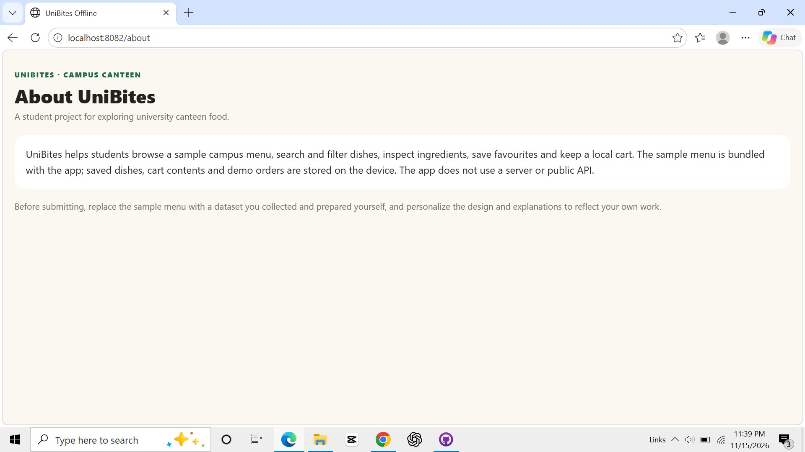
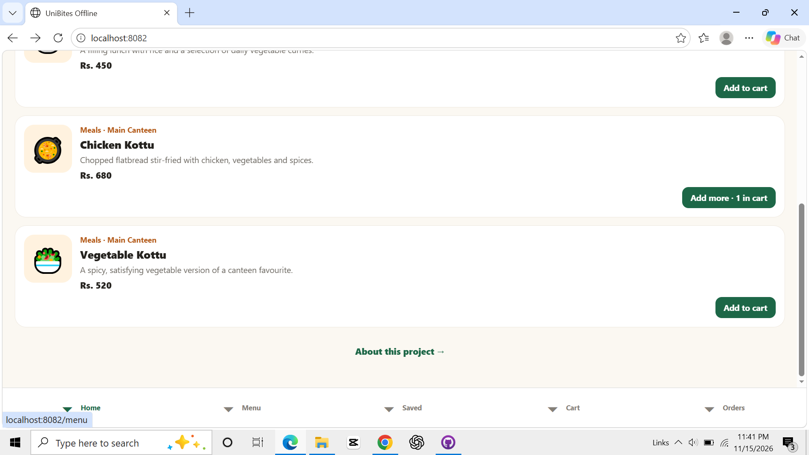

</details>

### Menu

<details>
<summary>Show Menu screenshots</summary>

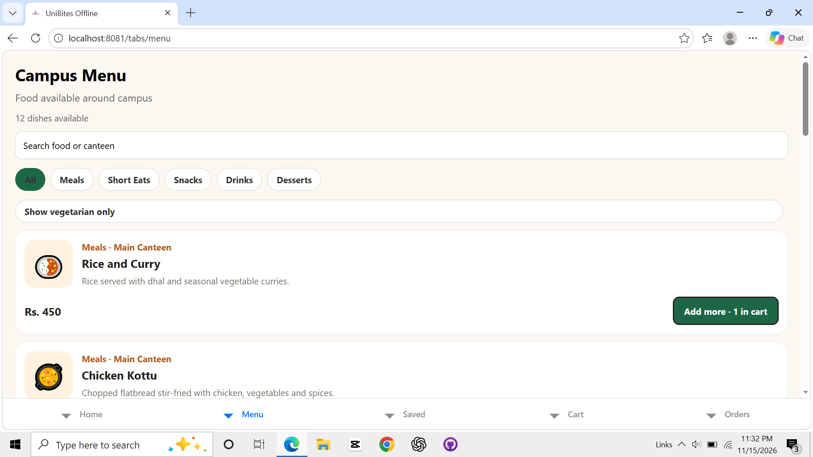
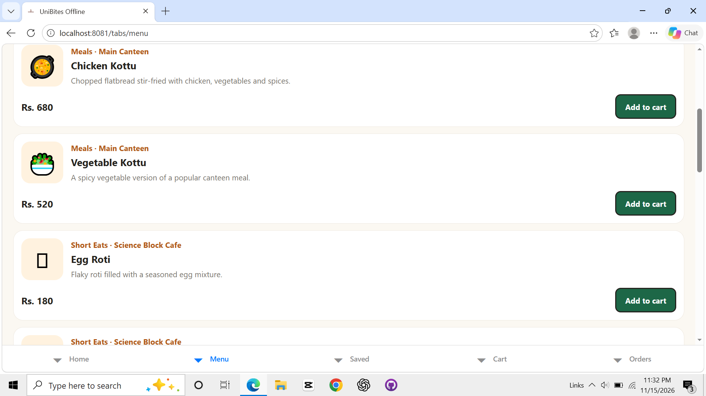
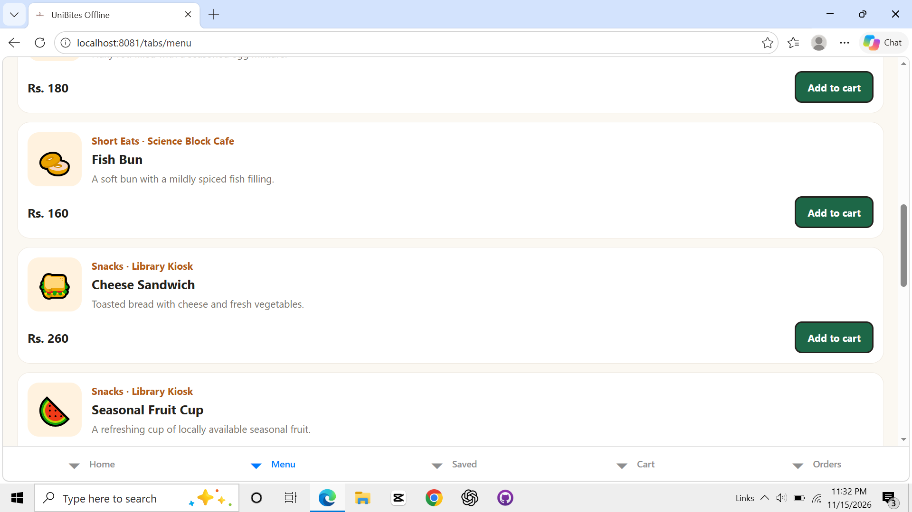
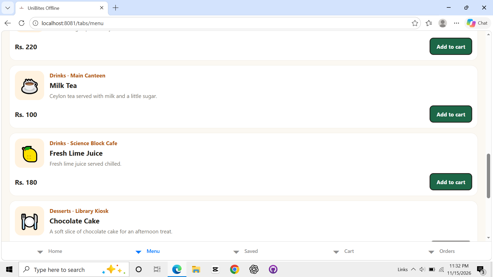
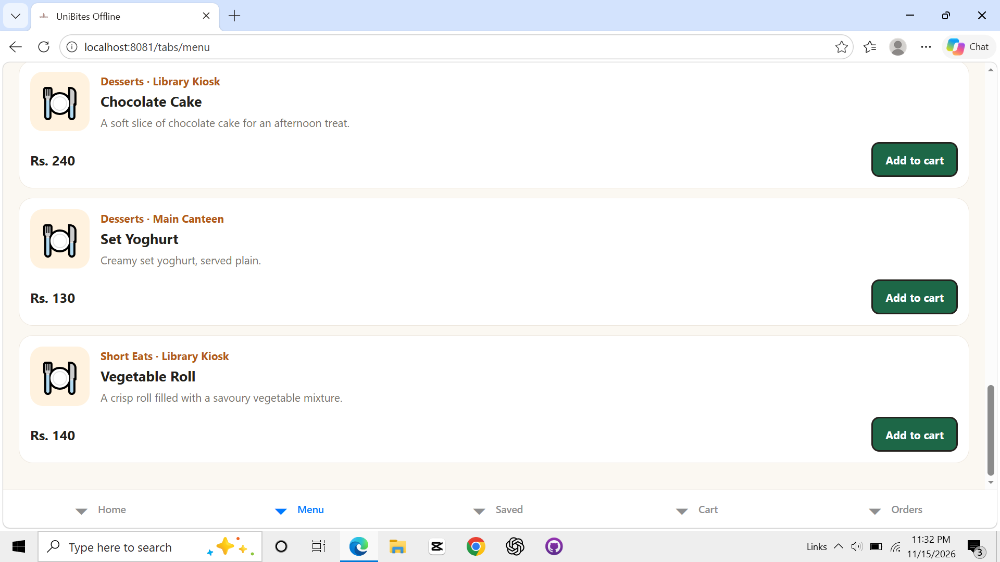
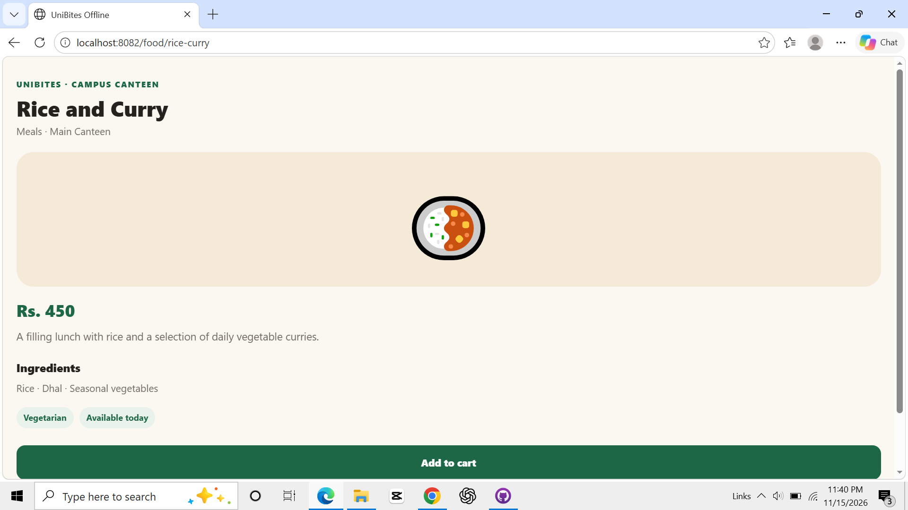
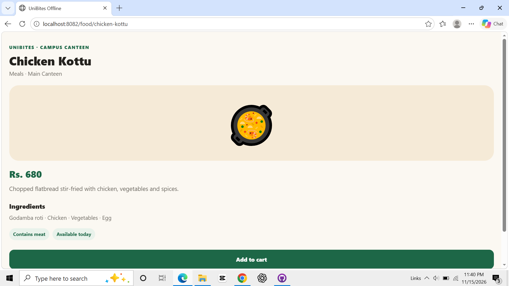

</details>

### Cart

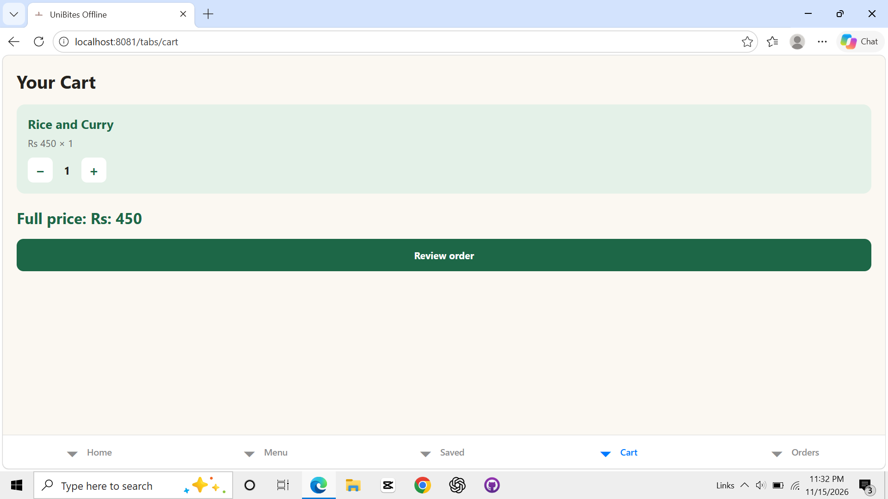

### Saved Dishes

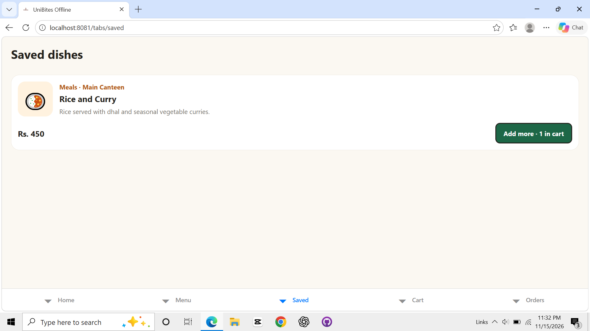

### Order History

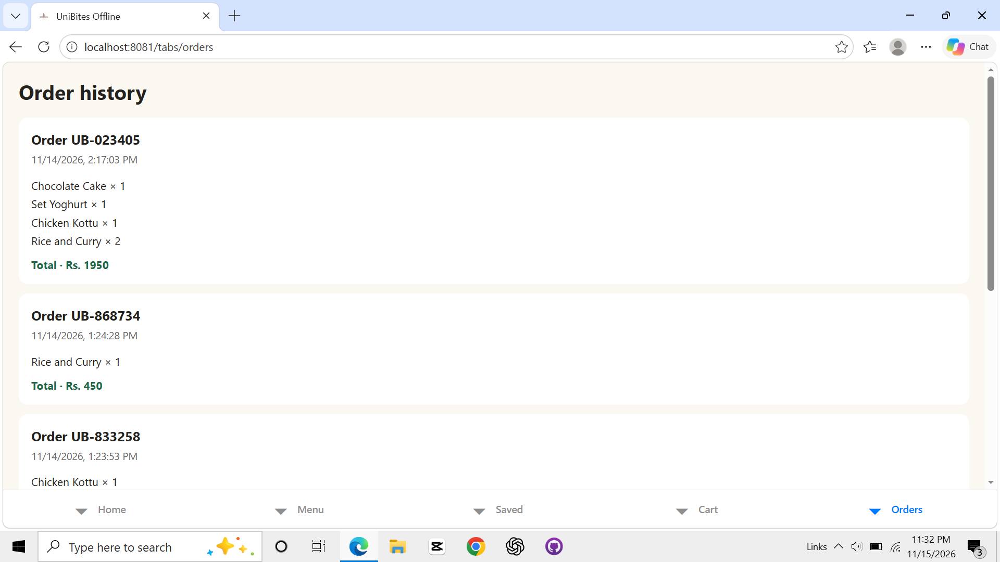

## 🧰 Technologies Used

- **React Native** — application interface
- **Expo** — development and app tooling
- **JavaScript and JSX** — application code
- **Expo Router** — navigation between screens
- **AsyncStorage** — local storage on the device
- **React Native Web** — browser preview

## 🗂️ Project Structure

```text
UniBite/
├── app/
│   ├── _layout.jsx
│   ├── index.jsx
│   ├── about.jsx
│   ├── checkout.jsx
│   ├── food/
│   │   └── [id].jsx
│   └── tabs/
│       ├── _layout.jsx
│       ├── index.jsx
│       ├── menu.jsx
│       ├── saved.jsx
│       ├── cart.jsx
│       └── orders.jsx
├── assets/
├── components/
│   └── FoodCard.jsx
├── context/
│   └── StoreContext.jsx
├── data/
│   └── foods.js
├── screenshots/
│   ├── Cart/
│   ├── Home/
│   ├── Menu/
│   ├── Orders/
│   └── Saved/
├── package.json
└── README.md
```

## 🚀 Installation and Setup

### Requirements

- Node.js
- npm
- Expo Go or an Android emulator

### Install the dependencies

```bash
npm install
```

### Start the application

```bash
npx expo start
```

To open the application in a web browser, press `w` in the Expo terminal. To run it on a phone, open Expo Go and scan the QR code.

## 💾 Offline Data Storage

The menu data is bundled locally in `data/foods.js`. The application does not need a public API or an online database to display the menu.

AsyncStorage is used to store the cart, saved dishes, and demo orders on the device. Checkout is a demonstration feature only. It does not take payment or send orders to a canteen.

## 📝 Important Notes

Menu items and prices should be checked and updated using information collected for this project. Confirm the details and any required attribution with the lecturer before submission.

This application was developed as an individual React Native project. Be prepared to explain how its features and code work.
